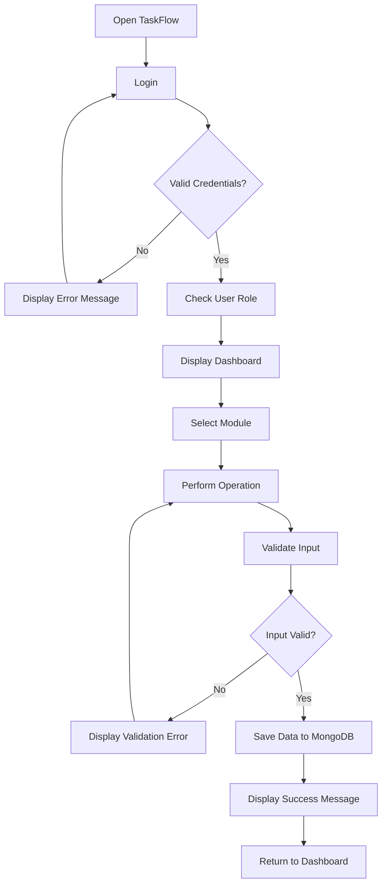
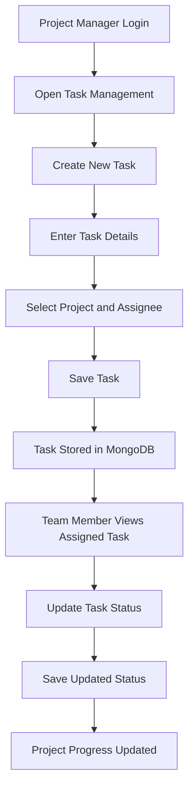

# TASKFLOW - APPLICATION WORKFLOW

## General Application Workflow

## Task Management Workflow

## Conclusion

The workflow explains how users interact with TaskFlow, how information is validated and how data is saved or updated in MongoDB.
