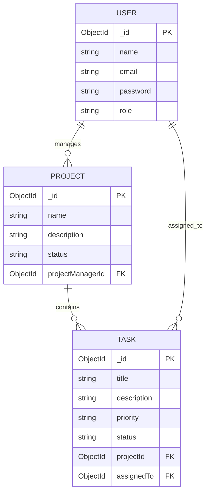

# TASKFLOW - ENTITY RELATIONSHIP DIAGRAM

## Main Entities

### 1. User
- _id (Primary Key)
- name
- email
- password
- role

### 2. Project
- _id (Primary Key)
- name
- description
- status
- projectManagerId (Reference to User)

### 3. Task
- _id (Primary Key)
- title
- description
- priority
- status
- projectId (Reference to Project)
- assignedTo (Reference to User)

## Entity Relationships

1. One User can manage multiple Projects.
2. One Project can contain multiple Tasks.
3. One User can be assigned multiple Tasks.
4. Each Task belongs to one Project.
5. Each Task is assigned to a User.

## ER Diagram

## Conclusion

The ER diagram shows the relationship between users, projects and tasks. MongoDB ObjectId references connect the related documents.
