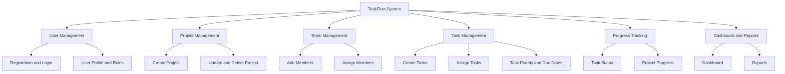

# TASKFLOW - MODULE DESIGN

## Project Overview

TaskFlow is a web-based Task and Project Management System developed using the MERN Stack.

## Main System Modules

1. User Management
   - User registration
   - User login
   - User profile
   - Role management

2. Project Management
   - Create project
   - View projects
   - Update project
   - Delete project
   - Manage project status

3. Team Management
   - Add team members
   - Assign members to projects
   - View project members

4. Task Management
   - Create tasks
   - Assign tasks
   - Update tasks
   - Delete tasks
   - Set task priority and due dates

5. Progress Tracking
   - Update task status
   - Monitor project progress
   - View completed and pending tasks

6. Dashboard and Reports
   - View project summaries
   - View task summaries
   - Generate reports

## Module Diagram

## Conclusion

The system is divided into six main functional areas to make development, testing and maintenance easier.
