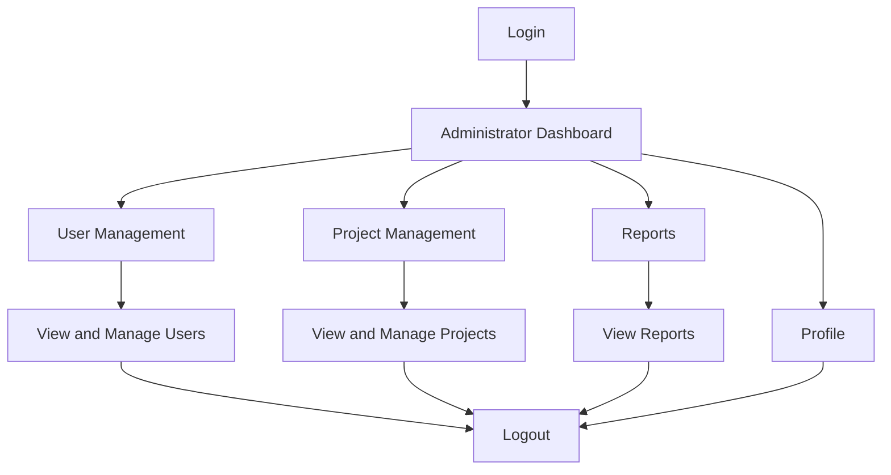
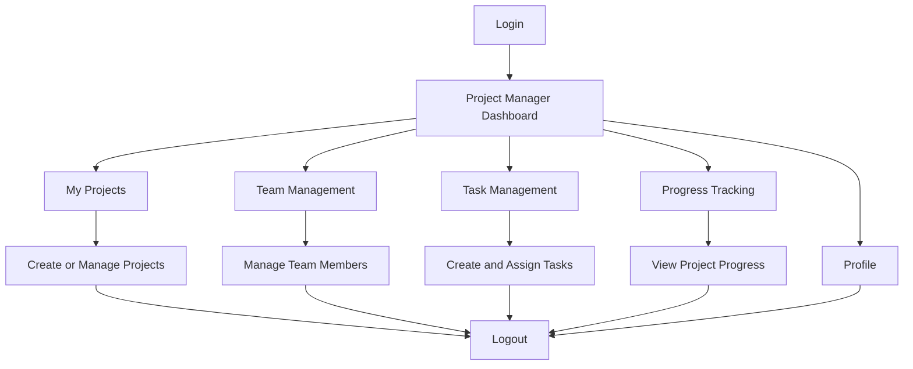
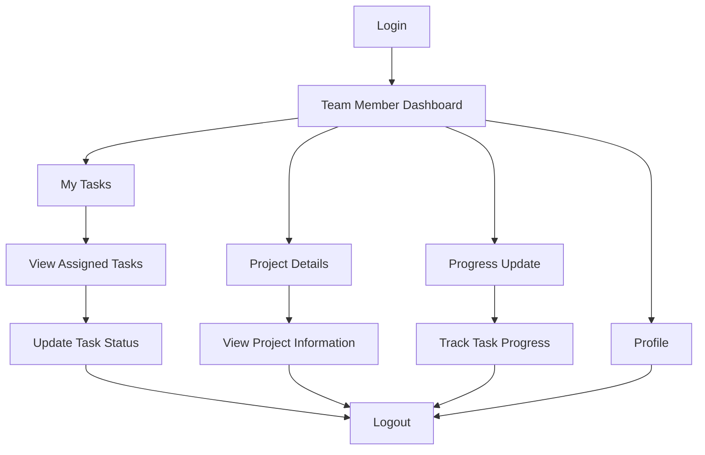

# TASKFLOW - APPLICATION NAVIGATION FLOW

## 1. Administrator Navigation

## 2. Project Manager Navigation

## 3. Team Member Navigation

## Conclusion

The navigation flow is designed according to the three user roles. Each user can access the features related to their responsibilities.
